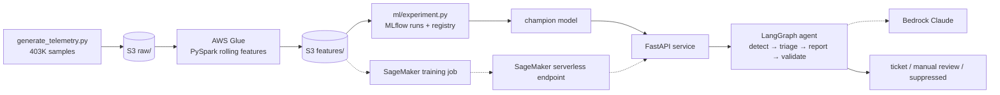

# Network Operations Intelligence Copilot

Anomaly detection and incident triage for a simulated 200-router BGP/OSPF fleet.


Solid lines run today. Dotted lines are written and wired but blocked by the AWS account (see **Status**).

## Status: what is real

| Phase | Component | Status |
|---|---|---|
| 1 | Telemetry simulator + PySpark features | **Done.** Runs locally and on AWS Glue. |
| 2 | Terraform: S3, least-privilege IAM, Glue job | **Done, deployed.** 11 resources (S3 bucket, 2 IAM roles, Glue job definition); IAM limits verified with the policy simulator. Nothing runs continuously: Glue only runs when a job is started. |
| 3 | Model + MLflow tracking and registry | **Done.** 6 candidates tracked; champion registered and reloaded from the registry. |
| 3 | SageMaker training + serverless endpoint | **Code written, not run.** Account quotas are 0 and the Free plan blocks SageMaker compute (`ResourceLimitExceeded`). |
| 4 | LangGraph agent + Pydantic retry loop | **Done.** 18 tests; runs over real test-day alerts. |
| 4 | Bedrock Claude call | **Code written, not run.** Free plan: `anthropic.claude-opus-5 is not available for this account`. Demos use a clearly labeled offline template in its place. |
| 5 | FastAPI service | **Done.** Runs locally with uvicorn; smoke-tested over HTTP. Not hosted in AWS. |
| 5 | Docker image + Kubernetes manifests | **Written, not built or deployed yet.** `Dockerfile` and `k8s/` are in place for a later step. |
| 6 | A/B test | **Done.** Router-randomized, stratified analysis, A/A-validated. |
| 7 | GitHub Actions CI | **Written.** Runs once the repo is pushed to GitHub. No image build or deploy step yet. |

Account note: after one successful Glue run, AWS started returning
`Account ... is denied access` on `StartJobRun`, an account-level Free-plan restriction.
`spark_jobs/feature_engineering.py --write-via-pandas` keeps the pipeline running locally.

---

## Phase 1: data + Spark

**Simulator** (`data/generate_telemetry.py`): 200 routers × 7 days × 5-minute samples =
403,200 rows of `latency_ms, packet_loss_pct, route_flap_count, bgp_session_state, traffic_mbps`.
Baselines depend on router role (core/aggregation/edge) and follow a diurnal load curve.

- **Incidents** (0.85% of rows) are injected as *episodes* of 3–18 samples:
  `latency_spike`, `packet_loss_burst`, `route_flap_storm`, `session_down`. Severity varies
  per episode, so some are subtle.
- **Benign look-alikes** are labeled in `benign_event`: micro-bursts, traffic surges, and
  night-time planned maintenance that resets BGP sessions. The first version had no benign
  noise: every model scored F1 ≈ 0.99 and the evaluation proved nothing. The benign events
  are what make false positives exist.

**Features** (`spark_jobs/feature_engineering.py`): per-router rolling windows via
`Window.partitionBy("router_id").orderBy(ts)`.
- Time-based windows (`rangeBetween` on epoch seconds), so missing samples don't stretch the window.
- The baseline excludes the current row, so a spike can't inflate its own mean and std.
- Z-scores are null, not 0, when history is short or variance is zero.
- Output is partitioned by `date`, not `router_id`, to avoid the small-files problem.

**Why Spark:** routers are independent, so the work partitions by router. 400K rows would
fit in pandas; the justification is production scale (thousands of routers, sub-minute
intervals, weeks of retention = 10⁸+ rows). The same script runs on Glue unchanged.

**Why per-router features:** a core router's latency spike (5 → 25 ms) is still below an
edge router's normal latency. One fleet-wide threshold can't catch it.

## Phase 2: Terraform + serverless Spark (AWS Glue)

`infra/`: private encrypted S3 bucket (`raw/`, `scripts/`, `features/`, `sagemaker/`), a Glue
5.0 job, and two IAM roles (Glue, SageMaker). The Spark script is deployed by `etag`.

Each role has a **trust policy** (only `glue.amazonaws.com` / `sagemaker.amazonaws.com`,
only for this account via `aws:SourceAccount`) and a **permission policy** scoped by prefix.
AWS-managed policies are deliberately not used. Verified with `aws iam simulate-principal-policy`:

| Role | Action | Resource | Decision |
|---|---|---|---|
| Glue | GetObject | `raw/*` | allowed |
| Glue | PutObject | `features/*` | allowed |
| Glue | Put/DeleteObject | `raw/*` | **denied**: can't damage its own input |
| Glue | PutObject | `scripts/*` | **denied**: can't modify its own code |
| Glue | GetObject | any other bucket | **denied** |
| SageMaker | GetObject | `features/*` | allowed |
| SageMaker | PutObject | `sagemaker/models/*` | allowed |
| SageMaker | PutObject | `features/*`, `sagemaker/code/*` | **denied** |

Glue run: 95 s, 190 DPU-seconds (≈ $0.02), 7 `date=` partitions, identical statistics to the local run.

## Phase 3: model + MLflow

`ml/experiment.py` trains every candidate on the same **time-based split**: days 1–4
train, day 5 validation (threshold and model selection), days 6–7 test (reported only).
A random split would leak, because neighbouring rows share rolling windows and episodes
would straddle the split.

| Run | Val PR-AUC | Test F1 | Precision | Recall | False alerts / router-day | Episode recall |
|---|---|---|---|---|---|---|
| Static thresholds (NOC baseline) | – | 0.71 | 0.60 | 0.88 | 1.62 | 0.91 |
| Isolation Forest (unsupervised) | 0.51 | 0.43 | 0.47 | 0.39 | 1.19 | 0.68 |
| HGB, unweighted | 0.92 | 0.90 | 0.96 | 0.84 | 0.11 | 0.99 |
| HGB, sqrt class weights | 0.92 | 0.90 | 0.95 | 0.86 | 0.13 | 0.99 |
| **HGB, balanced (champion)** | **0.92** | **0.92** | **0.96** | **0.88** | **0.09** | **1.00** |
| HGB, small/slow | 0.92 | 0.90 | 0.97 | 0.85 | 0.07 | 0.99 |

- **Champion:** registered as `noc-anomaly-detector@champion`, an MLflow pyfunc that bundles the model, threshold and feature code, so consumers can't drift from training. Predictions reloaded from the registry match training-time predictions exactly.
- **Known weakness:** latency-spike recall is 0.55. Mild spikes overlap with benign micro-bursts and surges.
- **Bug found and fixed:** with `l2_regularization=0`, unweighted boosting diverged (raw scores ≈ 1.4 million, PR-AUC 0.009). Leaf values are Newton steps g/(h+λ); on 99% one-class data near-pure leaves have h ≈ 0. Fixed with λ = 1 and a regression test.
- **SageMaker (written):** `ml/train.py` follows script mode (`SM_CHANNEL_FEATURES`, `SM_MODEL_DIR`) and runs unchanged locally. `ml/inference.py` implements `model_fn/input_fn/predict_fn/output_fn`. `ml/sagemaker_deploy.py` uses raw boto3 calls (CreateTrainingJob → CreateModel → CreateEndpointConfig with `ServerlessConfig` → CreateEndpoint). A serverless endpoint costs nothing while idle.

View runs with `mlflow ui --backend-store-uri sqlite:///mlflow.db`.

## Phase 4: LangGraph triage agent

```
detect ─(no alert)→ END
  └→ triage ─(planned change)→ suppress
            ─(P3)→ log_only
            ─(P1/P2)→ write_report → validate ─(valid)→ publish
                          ↑______________│ (invalid, attempts < 3: errors fed back)
                                         └─(3 failures or refusal)→ manual_review
```
- **Deterministic triage:** severity = role weight × failure-mode weight. Paging decisions must be auditable, so the LLM never decides them.
- **Change calendar:** suppresses session resets and flaps during planned maintenance windows, but not packet loss or latency, which maintenance doesn't explain.
- **Pydantic `IncidentReport`:** validates shape (enums, lengths) *and* meaning. A validator with context checks that the report names the alerting router, the triage severity and the detected type. No JSON schema can express those rules, which is why the retry loop is needed even with structured outputs.
- **Retry:** catch `ValidationError`, append the model's bad answer and the exact errors, retry up to 3 times, then route to manual review. A `refusal` stop reason goes straight to manual review.
- **Batch run** on real test-day alerts (`agent/run_batch.py`): 192 rows → 128 ticketed, 21 logged, 4 suppressed by the calendar, 39 not incidents.

## Phase 5: API, Docker, Kubernetes

`api/main.py`: `/healthz` (liveness), `/readyz` (readiness: model loaded), `/v1/detect`,
`/v1/triage`, `/v1/incidents`, `/metrics` (Prometheus). Configured by environment only.

- **Image:** multi-stage `Dockerfile`, non-root user, exact dependency pins (a pickled scikit-learn model needs the same version that trained it), exec-form CMD so SIGTERM reaches uvicorn.
- **Manifests (`k8s/`):** 2 replicas; rolling update with `maxUnavailable: 0`; separate readiness and liveness probes; CPU/memory requests and limits; read-only root filesystem; ConfigMap for settings; NodePort service on `localhost:30080`.

## Phase 6: A/B test (`ab_test/run_ab_test.py`)

Static thresholds (A) vs ML alerting (B), pre-registered:
- **Unit and assignment:** routers, randomized 50/50 and stratified by role.
- **Primary metric:** false alerts per router-day.
- **Guardrail:** episode recall, with a 5-point non-inferiority margin.

| | A: thresholds | B: ML |
|---|---|---|
| False alerts / router-day | 1.70 | **0.07** |
| Share of alerts that were noise | 39% | **3%** |
| Episode recall | 89% | **100%** |

- **Effect:** −1.63 false alerts per router-day (bootstrap 95% CI −2.05 to −1.25). Regression with role fixed effects and HC3 errors: p ≈ 10⁻²⁰. The guardrail passes. **Decision: ship B.**
- **Power:** detecting a 30% reduction would need 279 routers per arm. With 100 per arm, the minimum detectable effect is about 50%. The observed effect is far larger, but modest effects would be missed.
- **Naive test is wrong:** an alert-level z-test gives p ≈ 10⁻⁴⁵. The design effect is 10.3: correlated alerts inflate the apparent sample size.
- **A/A validation:** 500 splits. The first version (Welch t-test) had a **0.2%** false-positive rate, far too conservative because it ignored the stratification. The stratified regression gives **4.6%**, matching the nominal 5%.

## Phase 7: CI/CD (`.github/workflows/ci.yml`)

On every push or PR, the pipeline:
1. runs the unit tests;
2. rebuilds everything from scratch (generate → Spark → MLflow experiment → calendar → A/B test);
3. runs integration tests with the freshly trained model;
4. starts the API with uvicorn and sends it real test-day requests;
5. uploads the trained model and results as a build artifact.

Planned later: build the Docker image and deploy to Kubernetes from CI.

---

## Run it

```bash
python -m venv .venv && .venv\Scripts\activate          # Linux/macOS: source .venv/bin/activate
pip install -r requirements.txt
python data/generate_telemetry.py
python spark_jobs/feature_engineering.py                  # add --write-via-pandas on Windows
python ml/experiment.py
python -m agent.change_calendar
python agent/run_batch.py
python ab_test/run_ab_test.py
uvicorn api.main:app --port 8000
pytest -q                                                 # 47 tests
```

AWS (costs cents; `terraform destroy` removes everything):
```bash
terraform -chdir=infra init && terraform -chdir=infra plan -out=tfplan && terraform -chdir=infra apply tfplan
python spark_jobs/run_glue_job.py
python ml/sagemaker_deploy.py train | deploy | invoke | delete   # needs SageMaker quota / Paid plan
```

Docker + Kubernetes (later step, not yet tested; needs Docker Desktop with Kubernetes enabled):
```bash
docker build -t noc-copilot-api:latest .
kubectl apply -f k8s/config.yaml && kubectl apply -f k8s/deployment.yaml -f k8s/service.yaml
kubectl -n noc-copilot rollout status deployment/noc-copilot-api
python scripts/smoke_request.py http://localhost:30080
```
